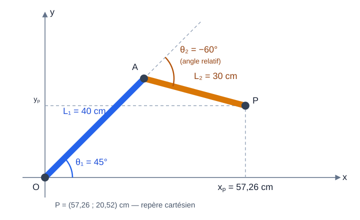

# RoboLab — Séance 1 : cinématique plane et Python

> CESI Prépa 1 — 4 h avec TP. Ce support sert de référence pendant les exercices.

## 1. Du robot au modèle
RoboTech Industries veut déplacer des pièces entre deux postes. Avant de choisir les moteurs, il faut savoir où la pince peut se trouver. La **cinématique** décrit le mouvement sans étudier les forces qui le produisent. La statique traite l'équilibre des forces ; la dynamique relie forces et accélérations. Aujourd'hui nous ne calculons ni couple, ni puissance, ni commande électrique.

Le R2 comporte deux segments rigides et deux articulations rotatives. La base O est fixe, A est le coude et P l'extrémité (assimilée à un point). Les longueurs sont 40 et 30 cm. Le mouvement est plan, les articulations peuvent tourner librement dans le modèle ; ni obstacles, ni collisions, ni butées ne sont considérés. Un robot réel impose des contraintes supplémentaires.



## 2. Repères, coordonnées et vecteurs
Dans un repère orthonormé, x est horizontal vers la droite et y vertical vers le haut. Un point P est décrit par deux coordonnées. Un vecteur AB est le déplacement de A vers B :

$$
\overrightarrow{AB}=(x_B-x_A,\ y_B-y_A)
$$

Les composantes peuvent être négatives ; une longueur ne l'est pas. La norme est donnée par Pythagore :

$$
d(A,B)=\sqrt{(x_B-x_A)^2+(y_B-y_A)^2}
$$

Exemple : A=(3,4), B=(6,8), donc AB=(3,4) et d=5 cm.

```python
import math
xA, yA = 3, 4
xB, yB = 6, 8
print(math.hypot(xB-xA, yB-yA))
```

Ne mélangez pas mètres et centimètres. Tous les calculs du TP utilisent les centimètres ; les angles saisis sont en degrés.

## 3. Angles et trigonométrie
Un tour vaut 360 degrés ou 2π radians. Le sens positif est antihoraire. Un angle négatif correspond au sens horaire. Les fonctions trigonométriques de Python attendent des radians.

$$
\theta_{rad}=\theta_{deg}\frac{\pi}{180}
$$

| Degrés | Radians | cosinus | sinus |
|---:|---:|---:|---:|
| 0 | 0 | 1 | 0 |
| 30 | π/6 | 0,866 | 0,5 |
| 45 | π/4 | 0,707 | 0,707 |
| 90 | π/2 | 0 | 1 |
| 180 | π | -1 | 0 |
| 270 | 3π/2 | 0 | -1 |

```python
import math
angle = 30
rad = math.radians(angle)
print(rad, math.sin(rad), math.cos(rad))
```

Erreur classique : `math.sin(30)` calcule le sinus de 30 radians. Pour revenir aux degrés, utiliser `math.degrees(rad)`. À essayer : comparer les sinus de 90 degrés et de 90 radians.

## 4. Cinématique directe d'un segment
La cinématique directe consiste à calculer une position à partir des angles connus. Les projections du segment sur les axes donnent :

$$
x=L\cos(\theta),\qquad y=L\sin(\theta)
$$

Pour un segment de 20 cm incliné à 60°, x=10 cm et y≈17,32 cm. La longueur reste 20 cm quelle que soit l'orientation, car cos²+sin²=1.

```python
import math
L = 20
angle = math.radians(60)
x = L * math.cos(angle)
y = L * math.sin(angle)
print(f"({x:.2f}, {y:.2f}) cm")
```

## 5. Fonctions et tuples
Une fonction reçoit des paramètres et renvoie un résultat. Séparer calcul et affichage permet de réutiliser et tester le calcul. Un tuple regroupe plusieurs valeurs ; le déballage les affecte à plusieurs variables.

```python
def deplacement(x, y, dx, dy):
    return x + dx, y + dy

position = deplacement(2, 3, 5, -1)
x, y = position
print(x, y)  # 7 2
```

`return` termine la fonction. `print` affiche seulement : il ne renvoie pas les coordonnées. Les paramètres sont locaux à la fonction. Documentez les unités dans les noms ou la docstring. À essayer : appeler la fonction deux fois avec des déplacements différents.

## 6. Deux articulations : addition de vecteurs
L'angle θ1 est absolu (par rapport à x). L'angle θ2 est relatif au premier segment. L'orientation absolue du second segment est donc θ1+θ2. Si θ1=90° et θ2=-90°, le second segment est horizontal vers la droite.

$$
x_A=L_1\cos(\theta_1),\qquad y_A=L_1\sin(\theta_1)
$$

$$
x_P=x_A+L_2\cos(\theta_1+\theta_2)
$$

$$
y_P=y_A+L_2\sin(\theta_1+\theta_2)
$$

On additionne les composantes des vecteurs OA et AP. Exemple avec deux segments de 10 cm, θ1=90° et θ2=-90° : A=(0,10), AP=(10,0), P=(10,10). L'erreur typique consiste à utiliser θ2 seul pour orienter le second segment.

## 7. Vérification numérique
Les flottants sont des approximations binaires. Le cosinus de π/2 peut être très proche de zéro sans être exactement nul. Une tolérance est nécessaire.

```python
import math
print(math.cos(math.pi/2))
print(math.isclose(math.cos(math.pi/2), 0, rel_tol=0, abs_tol=1e-9))
assert math.isclose(0.1 + 0.2, 0.3, rel_tol=0, abs_tol=1e-9)
```

`assert` déclenche une AssertionError si la condition est fausse (en exécution normale). Il sert ici aux tests, pas à la validation des saisies utilisateur. Pour contrôler une longueur saisie, utiliser `if` et refuser les valeurs non positives ou non finies (`math.isfinite`).

Les invariants du R2 sont d(O,A)=L1 et d(A,P)=L2. L'inégalité triangulaire impose :

$$
|L_1-L_2|\le d(O,P)\le L_1+L_2
$$

Utiliser une petite tolérance aussi aux bornes. Tester les bras alignés, repliés, perpendiculaires et des angles négatifs. Ne pas arrondir les coordonnées avant les tests ; arrondir seulement à l'affichage.

## 8. Boucles, listes et exploration
Une boucle `range(0,360,10)` génère 36 angles de 0 à 350. La borne finale est exclue. Deux boucles imbriquées parcourent toutes les combinaisons : 36 × 36 = 1296 configurations.

```python
xs, ys = [], []
for i in range(3):
    for j in range(2):
        xs.append(i)
        ys.append(j)
print(list(zip(xs, ys)))
```

Les deux listes doivent rester synchronisées. Le point d'indice i est `(xs[i], ys[i])`. `zip` associe les éléments de même indice. Une grille d'angles est un échantillonnage discret, pas une preuve de couverture continue.

## 9. Matplotlib : représenter le modèle
Installer avec `python -m pip install matplotlib` dans le terminal, pas dans le script. Vérifier l'interpréteur sélectionné dans VS Code.

```python
import matplotlib.pyplot as plt
plt.plot([0, 10, 15], [0, 5, 5], 'o-', label='Segments')
plt.xlabel('X (cm)')
plt.ylabel('Y (cm)')
plt.axis('equal')
plt.grid()
plt.legend()
plt.show()
```

`plot` relie les points dans l'ordre fourni ; `scatter` affiche des points indépendants. Un aspect égal évite de déformer les angles et les longueurs. Pour comparer des configurations, fixer les limites des axes et utiliser `plt.gca().set_aspect('equal')`. `show()` ouvre la fenêtre graphique ; fermer celle-ci pour terminer le script.

## 10. Espace de travail
L'ensemble des positions atteignables par P est une couronne de rayons 10 et 70 cm pour le R2 idéal. Le rayon extérieur correspond aux segments alignés, le rayon intérieur aux segments repliés. Si les longueurs sont égales, le rayon intérieur est nul. Les points échantillonnés ne sont pas uniformément répartis car les angles sont uniformes, pas les positions cartésiennes.

## 11. Interpolation et animation (approfondissement)
Pour passer d'un angle initial à un angle final en N intervalles, on utilise :

$$
\theta_k=\theta_i+\frac{k}{N}(\theta_f-\theta_i),\quad k=0,\ldots,N
$$

20 intervalles donnent 21 configurations, départ et arrivée inclus. Cette interpolation impose des incréments angulaires constants, mais ne garantit pas une trajectoire cartésienne rectiligne ni une vitesse cartésienne constante.

```python
for k in range(5):
    print(10 + k/4 * (30-10))
```

Pour animer, créer une figure, puis mettre à jour les données d'une ligne à chaque configuration. Exemple indépendant :

```python
import matplotlib.pyplot as plt
fig, ax = plt.subplots()
ligne, = ax.plot([0, 1], [0, 0], 'o-')
ax.set(xlim=(0, 5), ylim=(-1, 1))
for k in range(5):
    if not plt.fignum_exists(fig.number):
        break
    ligne.set_data([k, k+1], [0, 0])
    plt.pause(0.1)
plt.show()
```

La pause sert à rafraîchir l'affichage ; elle ne constitue pas une horloge temps réel. Une commande réelle demanderait des limites de vitesse, des accélérations, une gestion des collisions et des sécurités.

## 12. Mémo et autoévaluation
| Outil | Usage |
|---|---|
| `math.radians(a)` | degrés vers radians |
| `math.sin`, `math.cos` | projections |
| `math.hypot(dx,dy)` | distance |
| `math.isclose` | comparaison tolérante |
| `return x,y` | tuple de coordonnées |
| `range` | parcours discret |
| `append` | mémorisation |
| `assert` | test d'un invariant |
| `plt.plot`, `plt.scatter` | tracés |

Avant le TP, expliquer : pourquoi additionner les angles ? Pourquoi conserver les flottants non arrondis ? Pourquoi 21 configurations pour 20 intervalles ? Pourquoi un nuage de points ne prouve-t-il pas à lui seul la couverture de toute la couronne ?

Passez au [TP](tp.md).
