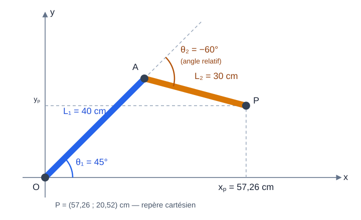

# RoboLab R2 — TP étudiant

**Mission :** développer un simulateur de cinématique directe pour RoboTech Industries. Durée 4 h avec cours et pauses. Travaillez dans l’ordre : les scripts réutilisent les fonctions précédentes. Copiez tous les scripts ensemble dans `mon_travail`. Les fonctions non complétées lèvent volontairement `NotImplementedError`. Ne modifiez pas leurs signatures. Les exemples de résultats sont arrondis pour l’affichage uniquement.

[Consulter le cours](cours.md).

Pour chaque exercice : prévoir le résultat, coder, exécuter, comparer et expliquer.

## Exercice 1 — Conversion des angles (10 min)

Fichier : [`ex01_conversion.py`](exercices/ex01_conversion.py).

Écrire la conversion manuelle, puis la comparer à math.radians pour 0, 30, 45, 90, 180 et 360 degrés. Afficher quatre décimales. Résultats : 0 ; 0,5236 ; 0,7854 ; 1,5708 ; 3,1416 ; 6,2832.

Exécuter : `python ex01_conversion.py` depuis le dossier contenant les scripts.

**À rendre :** script complété et résultats de vérification.

## Exercice 2 — Position du bras simple (15 min)

Fichier : [`ex02_bras_simple.py`](exercices/ex02_bras_simple.py).

Écrire position_bras(longueur, angle_deg), renvoyant x et y. Demander longueur et angle à l'utilisateur ; refuser une longueur non positive et les valeurs non finies. Pour 40 cm : 0° → (40,0), 30° → (34,64 ; 20), 45° → (28,28 ; 28,28), 90° → (0,40), 180° → (-40,0), 270° → (0,-40).

Exécuter : `python ex02_bras_simple.py` depuis le dossier contenant les scripts.

**À rendre :** script complété et résultats de vérification.

## Exercice 3 — Vérification géométrique (20 min)

Fichier : [`ex03_validation.py`](exercices/ex03_validation.py).

Écrire une fonction distance(x1,y1,x2,y2). Pour un bras de 40 cm, parcourir 0 à 360° inclus par pas de 15° (25 cas). Vérifier chaque distance avec math.isclose et afficher le nombre de succès. Expliquer pourquoi == est fragile.

Exécuter : `python ex03_validation.py` depuis le dossier contenant les scripts.

**À rendre :** script complété et résultats de vérification.

## Exercice 4 — Position du coude (10 min)

Fichier : [`ex04_coude.py`](exercices/ex04_coude.py).

Créer position_coude(L1,theta1) en réutilisant position_bras. Tester L1=40 cm pour 0°, 45°, 90°. Attendus : (40,0), (28,28 ; 28,28), (0,40).

Exécuter : `python ex04_coude.py` depuis le dossier contenant les scripts.

**À rendre :** script complété et résultats de vérification.

## Exercice 5 — Cinématique directe du R2 (20 min)

Fichier : [`ex05_bras_articule.py`](exercices/ex05_bras_articule.py).

Écrire position_robot(L1,L2,theta1,theta2), renvoyant xA,yA,xP,yP. Réutiliser position_coude et position_bras. Attention : le second angle est relatif. Tester les six configurations du tableau ci-dessous.

Exécuter : `python ex05_bras_articule.py` depuis le dossier contenant les scripts.

**À rendre :** script complété et résultats de vérification.

| θ1 (°) | θ2 (°) | xP (cm) | yP (cm) |
|---:|---:|---:|---:|
| 0 | 0 | 70.00 | 0.00 |
| 90 | 0 | 0.00 | 70.00 |
| 0 | 90 | 40.00 | 30.00 |
| 0 | 180 | 10.00 | 0.00 |
| 90 | -90 | 30.00 | 40.00 |
| 45 | -60 | 57.26 | 20.52 |

## Exercice 6 — Validation du modèle (15 min)

Fichier : [`ex06_tests.py`](exercices/ex06_tests.py).

Tester OA=L1, AP=L2 et la borne de OP pour les six configurations précédentes, puis pour une grille d'angles de pas 30°. Utiliser assert, math.isclose et une tolérance absolue de 1e-9 cm. Attendu : 144 configurations sur la grille sans échec. Ajouter un test de coordonnées connues pour détecter une erreur d'angle relatif.

Exécuter : `python ex06_tests.py` depuis le dossier contenant les scripts.

**À rendre :** script complété et résultats de vérification.

## Exercice 7 — Représentation graphique (20 min)

Fichier : [`ex07_visualisation.py`](exercices/ex07_visualisation.py).

Tracer O, A, P pour 45° et -60°. Utiliser plt.plot avec les listes de coordonnées, des marqueurs, une grille, des axes de -80 à 80 cm et un aspect égal. Ajouter titre et unités. Vérifier visuellement les orientations et essayer (90,-90).

Exécuter : `python ex07_visualisation.py` depuis le dossier contenant les scripts.

**À rendre :** script complété et résultats de vérification.

## Exercice 8 — Espace de travail (20 min)

Fichier : [`ex08_espace_travail.py`](exercices/ex08_espace_travail.py).

Parcourir les deux angles de 0 à 350° par pas de 10°. Mémoriser les coordonnées de P dans deux listes. Tracer avec scatter, aspect égal et unités. Vérifier 1296 points et les distances minimale/maximale de 10 et 70 cm. Refaire avec L2=40 puis L2=10 : rayons attendus 0–80 et 30–50 cm. Expliquer la couronne et la densité non uniforme.

Exécuter : `python ex08_espace_travail.py` depuis le dossier contenant les scripts.

**À rendre :** script complété et résultats de vérification.

## Exercice 9 — Interpolation des angles (bonus) (15 min)

Fichier : [`ex09_trajectoire.py`](exercices/ex09_trajectoire.py).

Interpoler de (0°,0°) à (90°,-90°) en 20 intervalles. Produire 21 tuples (theta1,theta2), puis les coordonnées de P. Tracer la trajectoire. Départ (70,0), arrivée (30,40), milieu (58,28 ; 28,28). Expliquer pourquoi le chemin est courbe.

Exécuter : `python ex09_trajectoire.py` depuis le dossier contenant les scripts.

**À rendre :** script complété et résultats de vérification.

## Exercice 10 — Animation du mouvement (bonus) (15 min)

Fichier : [`ex10_animation.py`](exercices/ex10_animation.py).

Réutiliser les 21 configurations. Créer une ligne pour O-A-P et une autre pour la trace de P. À chaque pas, mettre à jour les données avec set_data puis appeler plt.pause(0.1). Fixer les axes et arrêter la boucle si la fenêtre est fermée. Vérifier les positions initiale et finale. Ne pas confondre animation et commande réelle.

Exécuter : `python ex10_animation.py` depuis le dossier contenant les scripts.

**À rendre :** script complété et résultats de vérification.

## Bilan et évaluation
| Critère | Points |
|---|---:|
| Conversions et trigonométrie | 3 |
| Bras simple | 3 |
| Bras articulé | 5 |
| Tests géométriques | 3 |
| Visualisation | 3 |
| Espace de travail | 3 |
| Total | 20 |
| Animation et trajectoire (bonus) | +2 |

Remettre les scripts et une courte synthèse des tests, avec les deux graphiques (bras et espace de travail). Expliquer la convention des angles, les limites du modèle et l'intérêt des tests. Les exercices 9 et 10 sont facultatifs.
