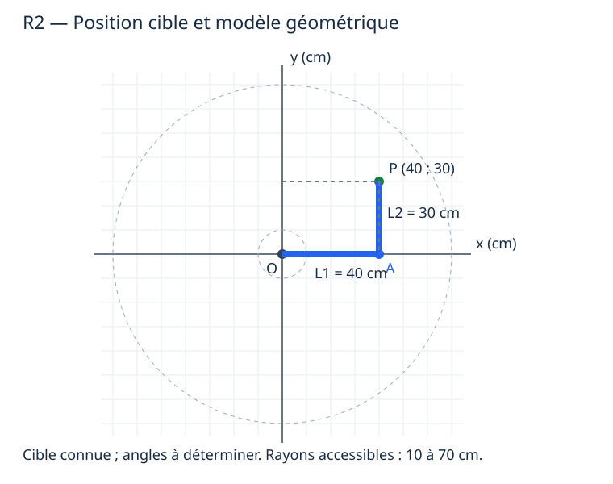
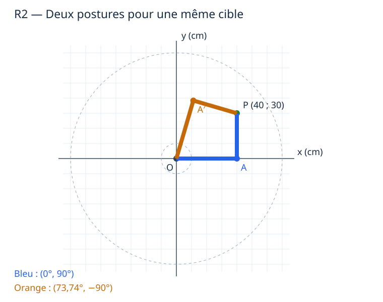
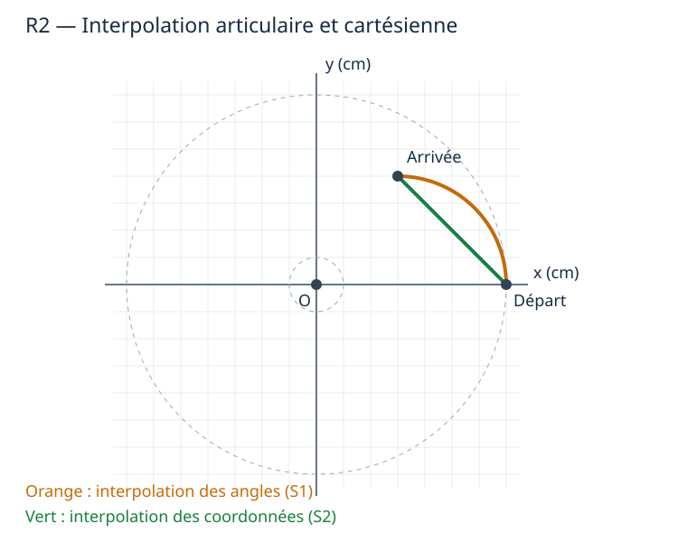

# RoboLab S2 — De la position à la commande articulaire

## 1. Mission et modèle

RoboTech Industries souhaite déplacer des pièces entre deux postes. Le logiciel reçoit une cible cartésienne et doit produire des angles articulaires. Nous étudions un robot plan idéal à deux pivots, de longueurs $L_1=40$ cm et $L_2=30$ cm. Les angles sont en degrés dans les interfaces Python, en radians dans les fonctions trigonométriques. Le sens positif est antihoraire. Le coude est relatif au premier segment. Aucune butée, collision, masse ou dynamique n'est modélisée.



## 2. Rappel : cinématique directe

Le coude A est situé à :

$$
x_A=L_1\cos\theta_1,\qquad y_A=L_1\sin\theta_1
$$

Le deuxième segment est orienté de $\theta_1+\theta_2$ par rapport à l'horizontale. Par addition des vecteurs OA et AP :

$$
x=L_1\cos\theta_1+L_2\cos(\theta_1+\theta_2)
$$

$$
y=L_1\sin\theta_1+L_2\sin(\theta_1+\theta_2)
$$

Le problème direct fournit une position pour chaque paire d'angles. Le problème inverse cherche toutes les postures correspondant à une position.

## 3. Accessibilité : démonstration

La norme du vecteur OP est $d=\sqrt{x^2+y^2}$. L'inégalité triangulaire donne $d\le L_1+L_2$. L'inégalité triangulaire inverse donne $d\ge |L_1-L_2|$. Ces bornes sont atteintes lorsque les segments sont alignés, respectivement étendus et repliés. En faisant varier le coude continûment entre ces postures, toutes les distances intermédiaires sont atteintes ; l'épaule permet ensuite toute orientation.

$$
|L_1-L_2|\le d\le L_1+L_2
$$

Pour R2, la zone accessible est une couronne fermée de rayons 10 et 70 cm. Les frontières sont incluses. `math.hypot(x,y)` calcule la norme. Les longueurs doivent être strictement positives et toutes les entrées finies (`math.isfinite`). Dans ce TP, on suppose des longueurs distinctes ; le cas de longueurs égales et cible à l'origine possède une infinité de solutions et est hors périmètre.

## 4. Trigonométrie inverse

`math.acos(c)` renvoie un angle dans [0, π], pour c dans [-1,1]. Le cosinus étant pair, les angles opposés ont le même cosinus. `math.atan(y/x)` ne distingue pas les quadrants opposés et échoue si x=0. `math.atan2(y,x)` utilise les deux signes et renvoie une orientation dans [-π,π]. L'origine n'a pas d'orientation géométrique.

```python
import math
print(math.degrees(math.acos(0.5)))  # 60
print(math.degrees(math.atan2(1, -1)))  # 135
```

## 5. Démonstration du calcul du coude

En élevant au carré les deux équations directes puis en les additionnant :

$$
d^2=L_1^2+L_2^2+2L_1L_2[\cos\theta_1\cos(\theta_1+\theta_2)+\sin\theta_1\sin(\theta_1+\theta_2)]
$$

L'identité $\cos(a-b)=\cos a\cos b+\sin a\sin b$ simplifie le terme croisé :

$$
d^2=L_1^2+L_2^2+2L_1L_2\cos\theta_2
$$

C'est aussi Al-Kashi, avec l'angle intérieur du triangle en A égal à $\pi-\theta_2$ pour un coude positif. On isole le cosinus :

$$
c=\frac{x^2+y^2-L_1^2-L_2^2}{2L_1L_2},\qquad \theta_2=\pm\arccos(c)
$$

Exemple : pour (40,30), $d^2=2500$, $c=0$ et le coude vaut ±90°. Vérifier l'accessibilité avant de borner c dans [-1,1] : le bornage ne doit jamais transformer une vraie cible inaccessible en cible valide. Une tolérance de 1e-10 cm est admise aux frontières pour les calculs flottants.

## 6. Démonstration du calcul de l'épaule

Développons les formules d'addition :

$$
x=(L_1+L_2\cos\theta_2)\cos\theta_1-L_2\sin\theta_2\sin\theta_1
$$

$$
y=(L_1+L_2\cos\theta_2)\sin\theta_1+L_2\sin\theta_2\cos\theta_1
$$

Posons $u=L_1+L_2\cos\theta_2$ et $v=L_2\sin\theta_2$. Le vecteur (x,y) est le vecteur (u,v) tourné de l'angle de l'épaule. Son orientation est donc la somme de l'orientation de (u,v) et de l'épaule :

$$
\theta_1=\operatorname{atan2}(y,x)-\operatorname{atan2}(v,u)
$$

Pour (40,30) et un coude +90°, les deux orientations sont identiques : l'épaule vaut 0°. Pour le coude -90°, l'épaule vaut environ 73,7398°. Les deux postures atteignent la même cible.



Aux frontières, les deux solutions coïncident modulo 360°. On ne conserve qu'une posture. La normalisation dans [-180°,180°[ s'effectue par `(angle + 180) % 360 - 180`. Cette convention peut afficher -180° au lieu de +180° : ce sont des angles équivalents.

## 7. Contrats des fonctions et exceptions

Une fonction doit annoncer ses entrées, unités et résultat. `est_accessible` renvoie un booléen pour une cible valide ; une entrée non finie ou une longueur invalide déclenche `ValueError`. Le modèle inverse lève `ValueError` pour une cible inaccessible. Le programme principal peut intercepter cette erreur :

```python
try:
    valeur = math.acos(2)
except ValueError as erreur:
    print("Calcul impossible :", erreur)
```

Une liste de tuples représente les postures, par exemple `[(0,90),(73.7398,-90)]`. Ne pas arrondir les angles avant les calculs suivants : arrondir uniquement l'affichage.

## 8. Validation croisée

Pour chaque solution inverse, appliquer le modèle direct fourni en EX06. Mesurer l'erreur euclidienne entre la cible et la position reconstruite :

$$
\varepsilon=\sqrt{(x'-x)^2+(y'-y)^2}
$$

Le seuil de recette est 1e-9 cm sur les cas de référence. Tester les frontières, les quatre quadrants et les cibles impossibles. Un test de reconstruction ne suffit pas à prouver l'exhaustivité : vérifier aussi le nombre de solutions. Près des frontières, la cinématique inverse est sensible aux perturbations ; les angles peuvent varier fortement pour un petit déplacement.

## 9. Visualisation

Matplotlib permet de tracer les trois points O,A,P avec `plt.plot([0,xA,xP],[0,yA,yP], 'o-')`. Utiliser `plt.axis('equal')` pour conserver les proportions, des limites fixes et une légende pour chaque posture. Le cercle intérieur et le cercle extérieur matérialisent les limites théoriques.

## 10. Choisir une posture

Un angle est périodique : passer de 179° à -179° représente un écart minimal de 2°, et non 358°. On définit le déplacement signé minimal :

$$
\Delta(a,b)=((b-a+180)\bmod360)-180
$$

Puis le coût $C=|\Delta(\theta_{1,D},\theta_{1,F})|+|\Delta(\theta_{2,D},\theta_{2,F})|$. Comparer les coûts des solutions et retenir la première en cas d'égalité. Ce critère est géométrique, pas énergétique. Il suppose des articulations sans butées. Pour une animation continue, on peut ajouter les écarts minimaux aux angles précédents plutôt que de réinitialiser les angles normalisés à chaque pas.

## 11. Trajectoire cartésienne

Pour N intervalles, calculer N+1 points :

$$
P_k=P_D+\frac{k}{N}(P_F-P_D),\quad k=0,\ldots,N
$$

À chaque point, résoudre le modèle inverse et choisir une posture proche de la précédente. L'interpolation des angles (S1) n'est pas équivalente à l'interpolation des coordonnées (S2).



Deux extrémités accessibles ne garantissent pas un segment accessible : (-40,0) et (40,0) traversent la zone centrale interdite. Pour vérifier le segment entier, poser $D=P_F-P_D$. La distance au carré à l'origine est une fonction quadratique de t :

$$
f(t)=\|P_D+tD\|^2,\qquad f'(t)=2(P_D+tD)\cdot D
$$

Le minimum est atteint pour $t_*=-P_D\cdot D/\|D\|^2$, ramené dans [0,1]. Si D est nul, utiliser directement la distance du départ. Vérifier que cette distance minimale est au moins le rayon intérieur ; le disque extérieur étant convexe, les deux extrémités suffisent pour sa borne. Cette vérification continue complète le simple échantillonnage.

## 12. Mission et limites

Une mission est une liste de dictionnaires décrivant des cibles et actions. La pince est un état logique : elle se ferme à l'arrivée au point de saisie et s'ouvre à l'arrivée au point de dépose. Préparer toutes les trajectoires avant de lancer l'animation ; en cas d'erreur, refuser la mission entière. Les positions intermédiaires ne garantissent pas l'absence de collision des segments. Aucun ordre n'est envoyé à un moteur réel. Les singularités, vitesses, couples, obstacles et limites mécaniques seront étudiés ultérieurement.

## 13. Mémo

- Degrés en entrée et sortie, radians dans `sin`, `cos`, `acos`, `atan2`.
- `hypot` pour les distances ; `isfinite` pour contrôler les entrées.
- Vérifier la cible avant `acos` ; dédupliquer les postures limites.
- Valider inverse puis direct, sans arrondir les résultats intermédiaires.
- Vérifier le segment entier avant d'animer ; conserver la continuité des angles.
