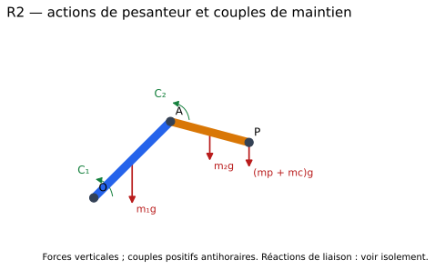
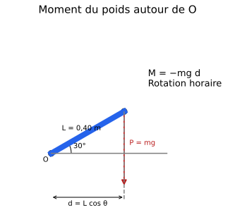
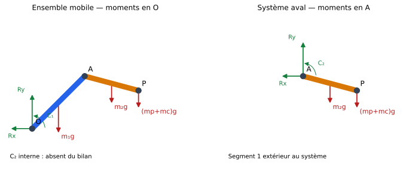
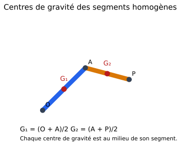

# RoboLab S3 — Forces, moments et couples moteurs

## 1. Problématique et hypothèses

Une cible accessible en cinématique inverse n'est pas nécessairement accessible avec une charge donnée. Le robot R2 est un mécanisme plan à deux pivots, dans un **plan vertical**. Le repère est direct : x vers la droite, y vers le haut, z sort de la page. Les angles positifs sont antihoraires ; θ₂ est relatif au premier segment. Le robot est immobile, les segments rigides et homogènes, les pivots idéaux. La pince et la pièce sont assimilées à des masses ponctuelles en P. Les masses des actionneurs sont supposées incluses dans celles des segments ou négligées. Aucun obstacle, frottement, effort de contact ou accélération n'est modélisé.

| Grandeur | Valeur | Unité |
|---|---:|---|
| L1 | 0,40 | m |
| L2 | 0,30 | m |
| m1 | 1,20 | kg |
| m2 | 0,80 | kg |
| mp (pince) | 0,20 | kg |
| mc (pièce nominale) | 0,50 | kg |
| g | 9,81 | m/s² |
| Couple nominal épaule | 20 | N·m |
| Couple nominal coude | 8 | N·m |
| S (sécurité) | 1,5 | sans unité |

Ces valeurs fictives sont des hypothèses pédagogiques. Les couples nominaux sont supposés disponibles en continu à la sortie des articulations, dans les deux sens.



## 2. Forces et poids

Une force est un vecteur défini par un point d'application, une direction, un sens et une intensité (N). Une masse mesure l'inertie d'un corps (kg). Le poids est la force gravitationnelle :

$$\vec P=m\vec g=(0,-mg)$$

Un newton vaut un kg·m/s². Pour une pièce de 0,5 kg, le poids vaut 4,905 N, dirigé vers le bas. Les poids des segments sont 11,772 et 7,848 N ; celui de la pince est 1,962 N. Le poids total vaut 26,487 N. Une réaction de liaison est une force exercée par un support sur le système isolé. Elle ne doit pas être confondue avec le couple d'un moteur.

En Python, utiliser un flottant et conserver la précision jusqu'à l'affichage :

```python
masse = 0.5
g = 9.81
print(f"Poids : {masse*g:.3f} N")
```

## 3. Moment d'une force



Le moment en O mesure la tendance d'une force à faire tourner le système autour de O. Si le point d'application est B, le produit vectoriel donne :

$$\vec M_O=\overrightarrow{OB}\times\vec F$$

En développant le déterminant dans le plan :

$$M_{O,z}=x_B F_y-y_B F_x$$

Le signe est positif pour une rotation antihoraire, négatif pour une rotation horaire. L'unité est N·m. Le bras de levier est la distance **perpendiculaire** entre O et la ligne d'action de la force, et non nécessairement la longueur du segment. Pour le poids, Fx=0 et Fy=-mg :

$$M_{O,z}=-mgx_B=-mgL\cos\theta$$

À 0°, le moment vaut -mgL ; à 90°, il est nul ; à 180°, il vaut +mgL. Un poids non nul peut donc avoir un moment nul. Pour 1 kg et 0,4 m, l'amplitude vaut 3,924 N·m. Le moteur de maintien doit fournir le moment opposé. Le couple est un moment pur : il ne dépend pas du point de réduction, contrairement au moment d'une force.

## 4. Isolement et principe fondamental de la statique

Isoler signifie tracer une frontière autour du système étudié et remplacer les interactions avec l'extérieur par leurs actions mécaniques. Ne compter que les actions extérieures à cette frontière. Pour un système immobile :

$$\sum F_x=0,\qquad \sum F_y=0,\qquad \sum M_z=0$$



Pour l'ensemble du robot, la base exerce une réaction horizontale et verticale ainsi qu'un couple moteur C1. Les forces et le couple transmis au coude sont internes : ils s'annulent par action-réaction. La réaction horizontale vaut zéro, la réaction verticale vaut le poids total. Pour le système aval (segment 2, pince et pièce), le pivot A exerce une réaction et le couple C2. Sa réaction verticale vaut (m2+mp+mc)g, soit 14,715 N à charge nominale. En prenant les moments en A, la réaction de pivot ne contribue pas car son bras de levier est nul. Cette méthode élimine les inconnues de liaison sans supposer qu'elles sont nulles.

## 5. Géométrie et centres de gravité



Notons a=θ₁ et b=θ₁+θ₂. Le point A est le coude et P l'extrémité. Les coordonnées sont :

$$A=(L_1\cos a,L_1\sin a)$$
$$P=A+(L_2\cos b,L_2\sin b)$$

Pour un segment homogène, le centre de gravité est son milieu :

$$G_1=\frac{O+A}{2},\qquad G_2=\frac{A+P}{2}$$

Ainsi xG1=L1 cos(a)/2 et xG2=L1 cos(a)+L2 cos(b)/2. Les coordonnées verticales s'obtiennent avec les sinus. Les angles sont saisis en degrés mais les fonctions trigonométriques Python utilisent des radians : `math.radians(angle)`. Les longueurs S1/S2 en cm doivent être divisées par 100 avant le calcul des moments.

## 6. Démonstration du couple au coude

Isolons le système aval. Les poids agissent en G2 et P. Les distances horizontales signées depuis A sont L2 cos(b)/2 et L2 cos(b). L'équilibre des moments en A donne :

$$C_2-m_2g(x_{G_2}-x_A)-(m_p+m_c)g(x_P-x_A)=0$$

En substituant les coordonnées :

$$C_2=g\left[m_2\frac{L_2}{2}+(m_p+m_c)L_2\right]\cos b$$

Le segment 1 n'intervient pas dans ce bilan car il est extérieur au système isolé. Son orientation intervient néanmoins via b.

## 7. Démonstration du couple à l'épaule

Isolons l'ensemble mobile. En O, la réaction de base a un moment nul. Le couple interne C2 ne figure pas dans le bilan. On obtient :

$$C_1-m_1gx_{G_1}-m_2gx_{G_2}-(m_p+m_c)gx_P=0$$

Après substitution et regroupement :

$$C_1=g\left[\left(m_1\frac{L_1}{2}+(m_2+m_p+m_c)L_1\right)\cos a+\left(m_2\frac{L_2}{2}+(m_p+m_c)L_2\right)\cos b\right]$$

Ces couples sont signés. Un moteur peut devoir compenser dans les deux sens. À l'horizontale déployée et à 0,5 kg, les contributions à C1 sont 2,3544 + 4,3164 + 4,8069 = 11,4777 N·m. C2 vaut 3,2373 N·m. À la verticale déployée, les couples sont nuls, mais les réactions de liaison ne le sont pas.

## 8. Validation numérique

Un flottant ne représente pas exactement toutes les valeurs réelles. `math.cos(math.pi/2)` n'est pas exactement zéro. Utiliser `math.isclose(valeur, attendu, rel_tol=0, abs_tol=1e-9)` et comparer les valeurs non arrondies. Tester les signes, les configurations verticales et horizontales et les entrées invalides (masses négatives, valeurs non finies). Les angles peuvent dépasser 360° : ils restent périodiques.

## 9. Dimensionnement et coefficient de sécurité

Le couple nominal n'est pas le couple de maintien calculé. On impose :

$$S|C_i|\le C_{i,nominal}$$

Le taux de sollicitation est :

$$u_i=\frac{S|C_i|}{C_{i,nominal}}$$

Un taux de 1 correspond à 100 %. Les deux moteurs doivent satisfaire le critère. À charge nominale et bras horizontal, les taux valent environ 86,08 % et 60,70 %. Le coefficient S ne doit pas être appliqué deux fois. Une cartographie articulaire explore θ1 et θ2 indépendamment avec deux boucles `range(-180,180,5)`. Les 72×72=5184 configurations ne dupliquent pas les extrémités périodiques. Une carte thermique représente les taux, pas les coordonnées cartésiennes. Le pourcentage de configurations admissibles sur cette grille n'est pas un pourcentage de surface accessible.

## 10. Charge utile maximale garantie

Les coefficients des cosinus sont positifs pour une charge non négative. Puisque |cos|≤1, les deux maxima absolus sont atteints lorsque le bras est entièrement déployé horizontalement. Pour le R2 :

$$|C_1|_{max}=9,81(0,82+0,70m_c)$$
$$|C_2|_{max}=9,81(0,18+0,30m_c)$$

On isole mc dans les inégalités de dimensionnement :

$$m_{c,1}\le\frac{20/(1,5\times9,81)-0,82}{0,70}$$
$$m_{c,2}\le\frac{8/(1,5\times9,81)-0,18}{0,30}$$

La plus petite borne fixe la charge garantie : environ 0,770 kg (épaule). Le coude autorise environ 1,212 kg. Si une borne est négative, le robot ne satisfait pas le critère même à vide. Une recherche numérique par incréments de 0,001 kg doit trouver 0,770 kg comme dernière masse admissible. La précision de la recherche dépend du pas ; elle ne remplace pas la preuve analytique. Une posture particulière peut accepter une masse supérieure, sans garantie sur les autres postures.

## 11. Mission et optimisation

Le module fourni `support_s2.py` reproduit la mission cartésienne de S2 en mètres, avec angles en degrés et sélection par continuité angulaire. Il fournit 141 configurations (7 segments, 20 intervalles chacun, sans duplication des jonctions). La pince se ferme à l'indice 40 et s'ouvre à l'indice 100. La masse de la pièce est donc présente pour les indices 40 à 99. À la dépose, contrôler aussi la charge juste avant ouverture (indice 100). Calculer les couples et les taux sur les échantillons, tracer les courbes, relever les maxima. Un contrôle échantillonné ne prouve pas la faisabilité continue ; la borne globale de la section 10 donne en revanche une garantie statique pour la charge nominale dans ce modèle.

Pour une cible donnée, la cinématique inverse fournit deux postures (sauf frontières). On peut comparer :

$$J=\max(u_1,u_2)$$

La posture minimisant J est la moins sollicitante selon ce critère local. Cela ne garantit ni la continuité du mouvement, ni une consommation minimale. Une cible inaccessible doit être rejetée. Une posture avec J>1 est non admissible.

## 12. Couple, puissance et limites

La puissance mécanique vaut $\mathcal P=C\omega$, en watts si ω est en rad/s. À l'arrêt, la puissance mécanique est nulle même si le couple ne l'est pas ; un moteur électrique peut néanmoins consommer et chauffer. En mouvement, il faut ajouter les effets d'inertie, de vitesse, de frottement et des charges externes. Le dimensionnement réel exige aussi des vérifications thermiques, structurelles et de transmission. Cette séance ne valide aucun robot physique.

## 13. Fiche mémo Python

- `math.sin`, `math.cos`, `math.radians` : géométrie.
- `abs`, `max`, `min` : contraintes et extrema.
- `math.isfinite`, `math.isclose` : validation.
- Dictionnaires : paramètres du robot ; listes de listes : cartes.
- `plt.plot`, `plt.imshow`, `plt.colorbar` : visualisation.
- `assert` : test pédagogique, pas contrôle d'entrée en production.

Questions de bilan : pourquoi le poids n'est-il pas un couple ? Pourquoi isoler le système aval ? Pourquoi le bras horizontal est-il le cas global le plus défavorable ? Pourquoi une charge admissible à l'arrêt ne garantit-elle pas un déplacement sûr ?
