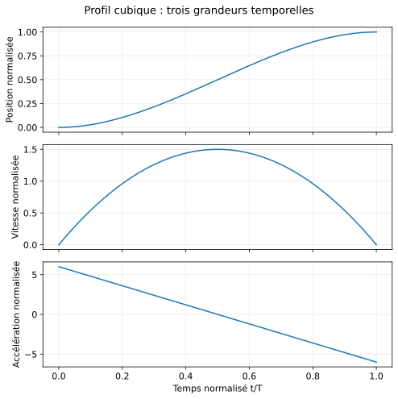
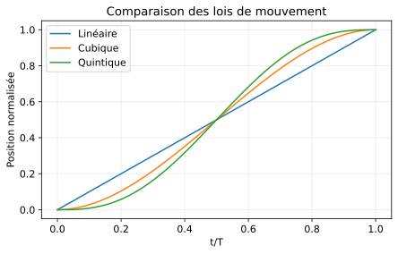
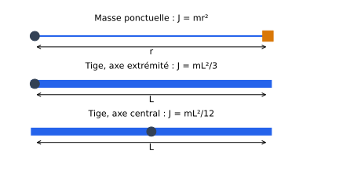
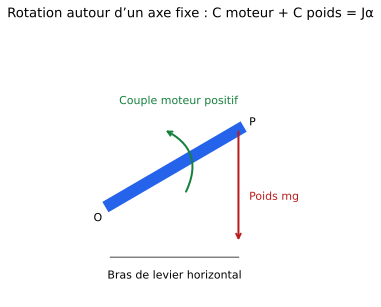
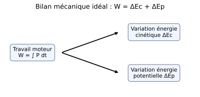

# RoboLab S4 — Dynamique, vitesse et puissance mécanique

## 1. Problématique et hypothèses
RoboTech Industries veut augmenter la cadence du robot R2. La statique (S3) vérifie le maintien d'une charge ; elle ne suffit pas à vérifier son déplacement. Nous cherchons une durée admissible pour un mouvement imposé, non la trajectoire optimale universelle.

Robot plan vertical, articulations idéales, tiges homogènes, pince et pièce ponctuelles en P. Pas de frottement, rotor, réducteur, collision ni limite thermique. Le sens positif est antihoraire ; le coude est relatif au premier segment. Les angles dynamiques sont en radians.

| Paramètre | Valeur |
|---|---:|
| L1, L2 | 0,40 ; 0,30 m |
| m1, m2 | 1,20 ; 0,80 kg |
| Pince, pièce nominale | 0,20 ; 0,50 kg |
| g | 9,81 m/s² |
| Couples nominaux | 20 ; 8 N·m |
| Vitesses limites | 2 ; 3 rad/s |
| Accélérations limites | 5 ; 8 rad/s² |
| Puissances limites | 40 ; 24 W |
| Sécurité sur le couple | 1,5 |

Les nouvelles limites sont fictives et indépendantes. Le couple est celui à l'articulation, non à l'arbre moteur avant réducteur.

## 2. Cinématique temporelle

La position $\theta(t)$ est une fonction du temps. La vitesse et l'accélération sont ses dérivées :
$$\omega=\frac{d\theta}{dt},\qquad \alpha=\frac{d\omega}{dt}.$$
Un angle de 90° vaut $\pi/2$ rad. Une vitesse négative indique une rotation horaire ; une accélération négative ne signifie pas nécessairement un ralentissement (il faut comparer les signes de vitesse et accélération).

Pour des mesures régulièrement espacées de $\Delta t$ :
$$\omega_{k+1/2}\simeq\frac{\theta_{k+1}-\theta_k}{\Delta t},\qquad \alpha_k\simeq\frac{\theta_{k+1}-2\theta_k+\theta_{k-1}}{\Delta t^2}.$$
Avec N positions, on obtient N−1 vitesses aux milieux des intervalles, puis N−2 accélérations aux instants intérieurs. Pour $\theta=t^2$, la différence seconde donne exactement 2 rad/s². Le bruit de mesure est amplifié par la dérivation ; diminuer le pas n'est pas toujours bénéfique.

## 3. Lois de mouvement

Posons $u=t/T$, $\Delta\theta=\theta_F-\theta_D$ et $\theta=\theta_D+\Delta\theta f(u)$. Le profil linéaire $f=u$ impose une vitesse constante mais des sauts de vitesse aux extrémités si le robot est au repos avant et après.

### Démonstration du profil cubique
On cherche $f=a+bu+cu^2+du^3$. Les conditions $f(0)=0$, $f'(0)=0$ donnent a=b=0. Les conditions $f(1)=1$, $f'(1)=0$ donnent c+d=1 et 2c+3d=0. Donc c=3, d=−2.
$$\theta=\theta_D+\Delta\theta(3u^2-2u^3)$$
La règle de dérivation en chaîne donne $du/dt=1/T$ :
$$\omega=\frac{\Delta\theta}{T}(6u-6u^2),\quad \alpha=\frac{\Delta\theta}{T^2}(6-12u).$$
Le maximum de vitesse est au milieu (accélération nulle) ; le maximum absolu d'accélération est aux extrémités :
$$|\omega|_{max}=\frac{1,5|\Delta\theta|}{T},\quad |\alpha|_{max}=\frac{6|\Delta\theta|}{T^2}.$$
Diviser T par deux double la vitesse et quadruple l'accélération. Le profil cubique présente des sauts d'accélération lors des raccordements à l'arrêt.

### Approfondissement : profil quintique
Imposer aussi $f''(0)=f''(1)=0$ conduit à $f=10u^3-15u^4+6u^5$. En effet les trois premiers coefficients sont nuls et les trois derniers satisfont a3+a4+a5=1, 3a3+4a4+5a5=0, 6a3+12a4+20a5=0.
$$f'=30u^2-60u^3+30u^4,\quad f''=60u-180u^2+120u^3.$$
Le quintique supprime les sauts d'accélération mais n'est pas systématiquement plus rapide. Pour les deux profils, T doit être strictement positif et t compris entre 0 et T.

## 4. Inertie

La masse mesure l'inertie de translation ; en rotation, la répartition de la masse importe. Une masse ponctuelle à distance r a pour inertie $J=mr^2$ (kg·m²). Doubler r quadruple J.
Pour une tige homogène de longueur L, la masse linéique est $\lambda=m/L$. Un élément dx a pour masse $dm=\lambda dx$. Son inertie autour d'une extrémité vaut $x^2dm$. En intégrant :
$$J_O=\int_0^L x^2\frac{m}{L}dx=\frac{mL^2}{3}.$$
Autour du centre, intégrer de −L/2 à L/2 donne $J_G=mL^2/12$.
Le théorème de Huygens-Steiner donne $J_O=J_G+md^2$ pour deux axes parallèles. Il résulte du développement de la distance au carré ; le terme croisé s'annule puisque le premier moment de masse autour du centre est nul.

## 5. Inertie équivalente du robot
Posons $m=m_p+m_c$ (pince et pièce). Lorsque l'épaule est bloquée, le coude entraîne uniquement le segment 2 et la masse terminale :
$$J_2=m_2L_2^2/3+mL_2^2.$$
Lorsque le coude est bloqué à l'angle relatif b, le robot tourne comme un solide autour de O. Les distances au carré sont
$$d_{G2}^2=L_1^2+L_2^2/4+L_1L_2\cos b,$$
$$d_P^2=L_1^2+L_2^2+2L_1L_2\cos b.$$
Par addition des inerties :
$$J_1=m_1L_1^2/3+m_2L_2^2/12+m_2d_{G2}^2+md_P^2.$$
Pour 500 g : J2=0,087 ; J1(0)=0,655 ; J1(90°)=0,391 kg·m². L'inertie de l'épaule ne dépend pas de son orientation absolue, mais dépend de l'angle du coude.

## 6. Dynamique à une articulation mobile

Isoler le solide entraîné autour de son axe fixe. Les réactions au pivot n'ont pas de moment autour de cet axe. Le poids crée un moment négatif lorsque le centre de gravité est à droite. Le moteur doit compenser le poids et produire l'accélération :
$$C_m+C_{poids}=J\alpha,\qquad C_m=G+J\alpha.$$
Le support S3 fournit G (couple de compensation, et non moment du poids). Pour le bras déployé, $G_1=9,81(0,82+0,7m_c)\cos\theta_1$. À 500 g, G1(0)=11,4777 N·m. Pour 90° en 2 s, le couple initial vaut 13,0210 N·m environ.

Attention : le moteur immobilisé doit lui aussi fournir un couple. Avec le coude bloqué, $\tau_2=G_2+M_{21}\alpha_1+h_2$. Avec l'épaule bloquée, $\tau_1=G_1+M_{12}\alpha_2+h_1$. Une vitesse nulle ne signifie pas un couple nul. EX06–08 étudient l'axe actif puis contrôlent aussi l'axe bloqué dans le scénario déployé (b=0, donc h2=0 et M21=0,219 kg·m² à 500 g).

## 7. Puissance et énergie

Le travail élémentaire d'un couple est $dW=C\,d\theta$. En divisant par dt :
$$P=C\omega,\qquad W=\int_0^T P(t)dt.$$
P>0 : énergie mécanique fournie ; P<0 : énergie absorbée. Une articulation immobile peut exercer un couple avec puissance mécanique nulle, mais consommer électriquement.
Sur chaque intervalle, approcher l'aire sous P par un trapèze :
$$W\simeq\sum_{k=0}^{N-1}\frac{P_k+P_{k+1}}2\Delta t.$$
On intégrera séparément max(P,0) et min(P,0) (approximation aux passages par zéro). Le travail net est leur somme. Pour un solide d'inertie constante, $E_c=J\omega^2/2$. L'énergie potentielle est $E_p=\sum_i m_i g y_i$. En multipliant l'équation dynamique par la vitesse et en intégrant, on obtient $W=\Delta E_c+\Delta E_p$. Pour le bras déployé allant de 0 à 90° au repos aux deux extrémités, W=11,4777 J. L'énergie électrique ne peut pas être déduite sans modèle de rendement.

## 8. Dimensionnement et recherche numérique
Pour chaque articulation, contrôler simultanément $S|\tau_i|\le C_{nom,i}$, $|\omega_i|\le\omega_{max,i}$, $|\alpha_i|\le\alpha_{max,i}$, $|P_i|\le P_{max,i}$. Le coefficient S ne s'applique ici qu'au couple. Pour un profil cubique, les bornes cinématiques donnent
$$T\ge\max\left(\frac{1,5|\Delta\theta|}{\omega_{max}},\sqrt{\frac{6|\Delta\theta|}{\alpha_{max}}}\right).$$
Explorer T par pas de 0,01 s, de 0,50 à 5,00 s. Utiliser des centièmes entiers pour éviter les dérives flottantes. La première durée admissible est minimale sur cette grille seulement. Si aucune durée ne convient, retourner None. Affiner l'échantillonnage pour vérifier la stabilité des maxima ; une grille ne constitue pas une preuve générale continue.

## 9. Dynamique couplée (bonus)
Les coordonnées généralisées sont $q=(a,b)$, avec b relatif. Le centre G1 est à $L_1/2$ de O ; G2 et P sont obtenus par addition de vecteurs orientés a et a+b. Pour G2, la vitesse est la somme de deux vecteurs tangents :
$$\|v_{G2}\|^2=L_1^2\dot a^2+(L_2/2)^2(\dot a+\dot b)^2+L_1L_2\cos b\,\dot a(\dot a+\dot b).$$
Pour P, remplacer L2/2 par L2 dans la somme vectorielle. Ajouter les énergies de translation des centres et les énergies de rotation propres des tiges ($J_G\omega^2/2$). En regroupant :
$$A=(m_1/3+m_2+m)L_1^2,\quad B=(m_2/3+m)L_2^2,\quad D=(m_2/2+m)L_1L_2.$$
$$E_c=\tfrac12 A\dot a^2+\tfrac12 B(\dot a+\dot b)^2+D\cos b\,\dot a(\dot a+\dot b).$$
Donc $E_c=\tfrac12\dot q^T M(q)\dot q$ avec
$$M=\begin{pmatrix}A+B+2D\cos b&B+D\cos b\\B+D\cos b&B\end{pmatrix}.$$
L'énergie potentielle est
$$V=g[(m_1/2+m_2+m)L_1\sin a+(m_2/2+m)L_2\sin(a+b)].$$
Ses dérivées redonnent les couples statiques S3. Les équations de Lagrange (fournies, hors exigence de démonstration individuelle) sont
$$\tau_i=\frac{d}{dt}\frac{\partial E_c}{\partial\dot q_i}-\frac{\partial E_c}{\partial q_i}+\frac{\partial V}{\partial q_i}.$$
Pour a, dériver $(A+B+2D\cos b)\dot a+(B+D\cos b)\dot b$ ; pour b, dériver $(B+D\cos b)\dot a+B\dot b$ puis soustraire $-D\sin b\dot a(\dot a+\dot b)$. On obtient
$$h_1=-D\sin b(2\dot a\dot b+\dot b^2),\quad h_2=D\sin b\dot a^2.$$
$$\tau=M\ddot q+h+G.$$
M est symétrique et définie positive pour les paramètres du robot. À vitesse et accélération nulles, retrouver S3. À coude verrouillé, M11=J1 ; à épaule verrouillée, M22=J2. Les termes hors diagonale expliquent les efforts sur l'articulation bloquée.

## 10. Mission Pick & Place
Réutiliser les huit cibles de S2 (mètres), sélectionner une solution inverse proche de la précédente et dérouler les angles pour éviter les sauts de 360°. Interpoler chaque paire de postures par le même profil cubique et une durée commune aux deux axes. Chaque étape commence et finit au repos. La trajectoire de P n'est généralement pas rectiligne ; aucune validation de collision n'est réalisée. La charge est nulle jusqu'à la saisie, puis nominale jusqu'à la dépose. Contrôler les deux états statiques lors de chaque changement de charge ; ne pas intégrer artificiellement une énergie de changement de masse. Les temps de pince sont exclus. Comparer 500 g et 1 kg, et différentes durées. Le bilan est une simulation idéale, pas une certification.

## 11. Mémo Python et validation
`math.radians`, `math.cos`, `math.sin`, `math.isclose`, `zip`, `max`, `abs`, listes et dictionnaires. Une grille de N intervalles contient N+1 points. Tester les extrémités, les unités, les signes, le retour à la statique et la convergence du travail. Tracer des axes légendés avec unités. Ne pas arrondir les valeurs avant les comparaisons.
