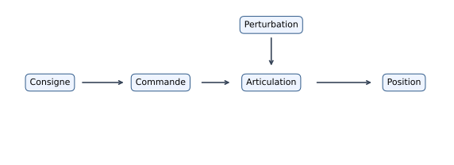
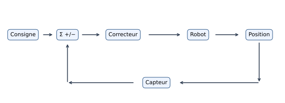
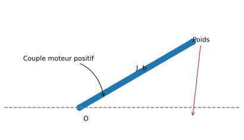
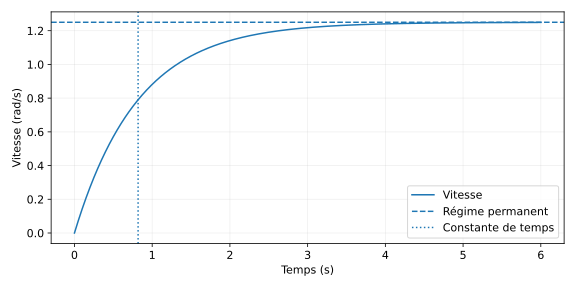
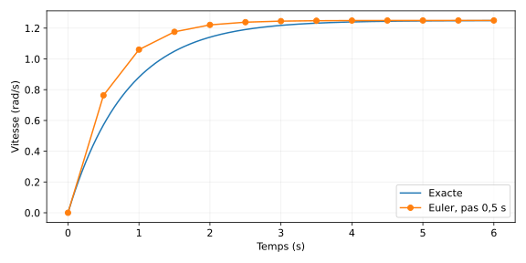
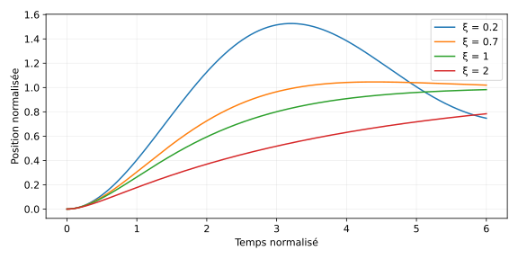
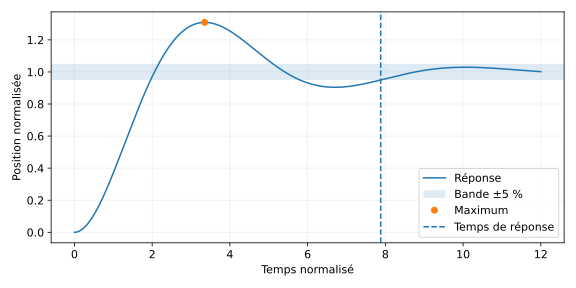
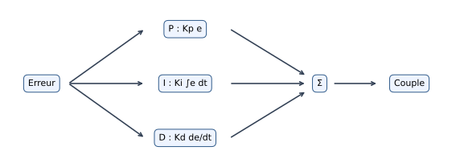
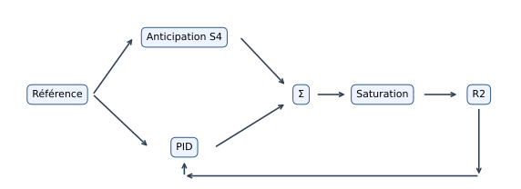

# RoboLab S5 — Automatique et asservissement

## 1. Problématique et conventions
Le robot R2 sait calculer une trajectoire (S1–S2) et les couples nécessaires (S3–S4). Une commande nominale ne garantit pourtant pas le suivi réel : masse inconnue, frottement, perturbation et bruit modifient la réponse. L'automatique utilise la mesure pour corriger les écarts. On travaille en SI : angles en radians, temps en secondes, couples en N·m. Les interfaces historiques S2/S3 utilisent les degrés ; le support S4 effectue la conversion.

Une commande ouverte ne dépend pas de la sortie. Elle peut être anticipative, mais ne corrige pas les erreurs du modèle.

La boucle fermée compare la consigne $\theta_c$ à la mesure $\theta_m$. L'erreur $e=\theta_c-\theta_m$ alimente le correcteur. Le signe négatif du retour est essentiel : une erreur positive doit normalement provoquer un effort positif. Un retour mal réglé peut déstabiliser le système.

## 2. Isolement mécanique

On verrouille le coude à zéro. L'épaule entraîne le bras déployé et une pièce de 0,5 kg. Le modèle S4 donne $J=0,655$ kg·m² et $G(\theta)=11,4777\cos\theta$ N·m. On ajoute un frottement visqueux pédagogique $b=0,8$ N·m·s/rad. Le moment du poids est négatif lorsque le bras est horizontal vers la droite. Le frottement s'oppose à la vitesse. Le couple perturbateur $d$ est signé.

Le théorème du moment dynamique autour de l'axe fixe donne :

$$J\ddot\theta=\tau_m-b\dot\theta-G(\theta)+d.$$

Si la commande compense exactement la pesanteur, $\tau_m=G(\theta)+u$, alors :

$$J\ddot\theta+b\dot\theta=u+d.$$

Cette simplification suppose un modèle exact et aucune saturation. Dans les exercices avancés on sature le couple **total**, pas seulement la correction. Limites épaule/coude : couple 20/8 N·m, vitesse 2/3 rad/s, accélération 5/8 rad/s², puissance 40/24 W. Le contrôle de dimensionnement applique 1,5 au couple absolu. Le simulateur sature à la limite physique, mais vérifie séparément la marge de sécurité.

## 3. Équation différentielle du premier ordre
Une équation différentielle relie une fonction inconnue à ses dérivées. Une condition initiale est nécessaire pour un premier ordre. Posons $\omega=\dot\theta$. Pour $u=U$ constant et $d=0$ :

$$J\dot\omega+b\omega=U.$$

Divisons par J et multiplions par le facteur intégrant $e^{bt/J}$ :

$$\frac{d}{dt}(e^{bt/J}\omega)=\frac{U}{J}e^{bt/J}.$$

En intégrant entre 0 et t :

$$\omega(t)=\frac{U}{b}+(\omega_0-\frac{U}{b})e^{-bt/J}.$$

Pour une vitesse initiale nulle, la vitesse atteint 63,2 % de sa valeur finale à $\tau=J/b$. La bande à 5 % est atteinte lorsque $e^{-t/\tau}=0,05$, soit $t_5=-\tau\ln(0,05)$. Avec U=1, la vitesse finale vaut 1,25 rad/s et la constante de temps 0,81875 s. Le modèle suppose b strictement positif.

En intégrant la vitesse, pour un départ au repos :

$$\theta(t)=\theta_0+\frac{U}{b}[t-\tau(1-e^{-t/\tau})].$$

La position croît sans borne pour U positif : stabiliser une vitesse ne stabilise pas une position.

## 4. Euler explicite et représentation d'état
Une dérivée est une limite de taux d'accroissement. Le développement de Taylor donne $y(t+h)=y(t)+h y'(t)+O(h^2)$. On néglige le reste :

$$y_{k+1}=y_k+h f(t_k,y_k).$$

L'erreur locale est d'ordre 2 et l'erreur globale d'ordre 1 sur un horizon fixe, sous hypothèses de régularité et de stabilité. Diviser le pas par deux réduit approximativement l'erreur globale par deux dans le régime asymptotique.

Pour la position, deux conditions initiales sont nécessaires. On transforme l'équation du second ordre en deux équations du premier ordre :

$$\dot\theta=\omega,\qquad \dot\omega=(u+d-b\omega)/J.$$

Euler explicite utilise exclusivement les anciennes valeurs :

$$\theta_{k+1}=\theta_k+h\omega_k,\qquad \omega_{k+1}=\omega_k+h(u_k+d_k-b\omega_k)/J.$$

En Python, calculer les deux nouvelles valeurs avant de remplacer les anciennes. Une mise à jour séquentielle utilisant la nouvelle vitesse correspond à un autre schéma.

### Stabilité numérique
Pour le premier ordre, posons $z_k=\omega_k-U/b$. Alors $z_{k+1}=(1-hb/J)z_k$. La suite tend vers zéro si la valeur absolue du multiplicateur est strictement inférieure à 1. Donc $0<h<2J/b=1,6375$ s. Au-delà, l'erreur croît ; à la frontière elle oscille sans décroître. Un système physique stable peut être numériquement instable. Cette borne ne s'applique pas directement au PID : ses pôles sont différents.

## 5. Correcteur proportionnel
Pour une consigne constante, $u=K_p(\theta_c-\theta)$. Substituons :

$$J\ddot\theta+b\dot\theta+K_p\theta=K_p\theta_c+d.$$

Sans perturbation, la solution homogène s'obtient en essayant $e^{st}$, d'où $Js^2+bs+K_p=0$. Les racines sont $s=(-b\pm\sqrt{b^2-4JK_p})/(2J)$. Si J,b,Kp sont positifs, leurs parties réelles sont négatives. La forme canonique donne :

$$\omega_n=\sqrt{K_p/J},\qquad \xi=b/(2\sqrt{JK_p}).$$

Si $\xi<1$, les pôles complexes produisent une réponse oscillante amortie ; à 1, amortissement critique ; au-delà, deux pôles réels négatifs. Augmenter Kp accroît la pulsation propre mais diminue l'amortissement relatif.

Pour un échelon positif depuis le repos, le premier maximum intervient à $t_p=\pi/(\omega_n\sqrt{1-\xi^2})$. En substituant dans la réponse indicielle, on obtient le dépassement $100\exp(-\pi\xi/\sqrt{1-\xi^2})$ %. Cette formule suppose le modèle canonique sans saturation.

## 6. Mesurer les performances

- Dépassement : maximum de zéro et de $(\max\theta-\theta_c)/\theta_c$ multiplié par 100, pour un échelon positif depuis zéro.
- Temps de montée : différence entre les premiers franchissements de 10 % et 90 %.
- Temps de réponse à 5 % : premier instant après le dernier échantillon hors bande. Si le dernier échantillon est hors bande, retourner None. Ce résultat est limité à l'horizon observé.
- Erreur finale signée : consigne moins dernière mesure ; ce n'est pas nécessairement l'erreur asymptotique.
- IAE : intégrale de l'erreur absolue. Par trapèzes, additionner $h(|e_k|+|e_{k+1}|)/2$.

Pour une perturbation constante résistante $d=-D$, à l'équilibre les dérivées sont nulles. Ainsi $K_pe=D$ et $e=D/K_p$. Une perturbation de 1 N·m laisse 0,1 rad d'erreur avec Kp=10. Un gain élevé réduit cette erreur mais peut accroître les oscillations et le couple demandé.

## 7. PI, PD et PID

Le correcteur idéal combine trois contributions :

$$u=K_pe+K_i\int_0^t e(s)ds+K_d\dot e.$$

Unités : Kp en N·m/rad, Ki en N·m/(rad·s), Kd en N·m·s/rad. P réagit immédiatement, I mémorise l'erreur, D amortit les variations. Pour une consigne constante, $\dot e=-\omega$. On utilise cette dérivée sur la mesure pour éviter le pic dû à un échelon de consigne. Pour une trajectoire continue on pourra utiliser $\dot e=\omega_c-\omega$.

L'intégrale discrète candidate est $I^*=I_k+h e_k$. Le couple candidat vaut $G+K_pe+K_i I^*-K_d\omega$. Si le couple dépasse la limite positive et que l'erreur est positive, bloquer l'intégration ; idem pour limite négative et erreur négative. Sinon accepter I*. Recalculer ensuite le couple correctif avec l'intégrale retenue. Cette stratégie d'intégration conditionnelle limite le windup. Elle ne garantit pas la stabilité non linéaire.

### Stabilité continue
Pour PD, le polynôme caractéristique est $Js^2+(b+K_d)s+K_p$. Le gain dérivé augmente l'amortissement. Pour PI/PID avec Ki strictement positif, on ajoute l'état intégral $\dot I=e$. En dérivant l'équation homogène ou en éliminant I, on obtient :

$$Js^3+(b+K_d)s^2+K_ps+K_i=0.$$

Le tableau de Routh a pour première colonne J, b+Kd, $[(b+K_d)K_p-JK_i]/(b+K_d)$, Ki. Tous doivent être strictement positifs pour la stabilité asymptotique. Pour des gains positifs :

$$(b+K_d)K_p>JK_i.$$

À égalité, le modèle n'est pas asymptotiquement stable. Pour Ki=0 utiliser le modèle du second ordre, sans état intégral actif. Ce critère concerne le modèle continu linéaire, pas la saturation ni Euler. Une intégrale stable et non saturée impose e=0 à l'équilibre sous perturbation constante.

## 8. Optimiser sous contraintes
Un bon réglage minimise l'IAE sans violer les limites mécaniques. Une grille finie teste chaque combinaison de gains. Créer un correcteur neuf à chaque essai pour réinitialiser son intégrale. Rejeter les candidats instables selon le modèle linéaire puis vérifier la simulation. Un minimum sur grille n'est pas un optimum global. Si aucun candidat ne convient, retourner None, ne pas inventer de solution. Un échelon brutal peut être incompatible avec les limites d'accélération : une trajectoire lissée est alors préférable.

## 9. Robot complet et suivi de trajectoire

Le modèle S4 est $M(q)\ddot q+h(q,\dot q)+G(q)=\tau$. Le modèle réel simulé ajoute les frottements et une perturbation. La commande anticipative calcule $\tau_{ff}=M(q_c)\ddot q_c+h(q_c,\dot q_c)+G(q_c)$ à partir de la masse nominale. La correction par axe utilise $K_pe+K_iI+K_d(\omega_c-\omega)$. Le moteur applique la somme saturée. Le support résout le système 2×2 pour obtenir l'accélération réelle puis applique Euler. Il conserve les états entre segments. La masse change aux événements programmés de saisie/dépose ; aucun contact physique n'est simulé.

Comparer anticipation seule, PID seul et combinaison. La référence est un profil cubique articulaire, pas une ligne droite cartésienne. La cinématique directe donne $x=L_1\cos q_1+L_2\cos(q_1+q_2)$ et $y=L_1\sin q_1+L_2\sin(q_1+q_2)$. L'erreur cartésienne est la distance euclidienne entre référence et mesure. La puissance par axe vaut $\tau_i\omega_i$ ; intégrer séparément les parties positive et négative. Ne pas confondre travail mécanique et consommation électrique. Les limites de vitesse, accélération et puissance sont évaluées, non imposées. Une simulation échantillonnée ne prouve pas la sécurité réelle.
