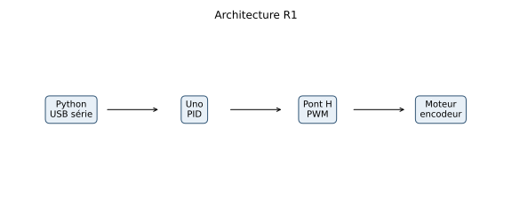
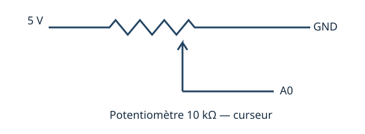
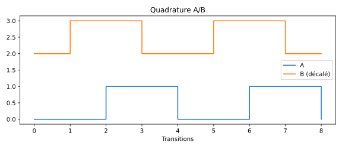
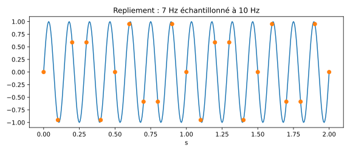
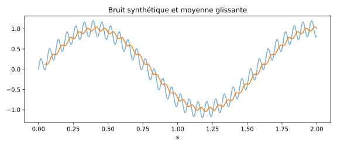
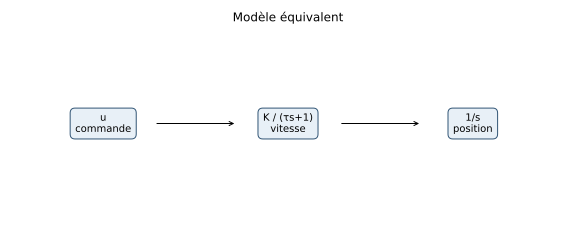
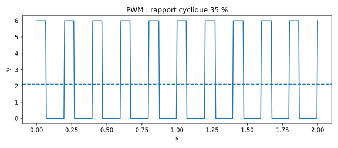
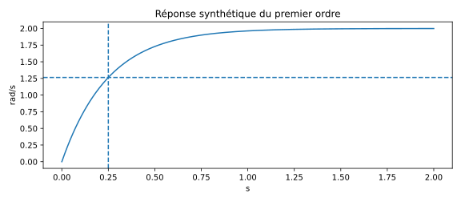
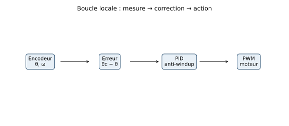

# Cours — Instrumentation, identification et commande numérique

## 1. Du robot R2 au banc R1

Le banc à un axe permet d'isoler les phénomènes physiques. R2 reste le modèle de référence conceptuel ; ses inerties et gains ne sont pas ceux de R1. Python supervise et analyse, Arduino exécute la boucle locale. Une validation numérique n'est pas une preuve de sécurité physique.

## 2. Capteurs et étalonnage

Le potentiomètre est un diviseur résistif. Pour un ADC 10 bits, 1024 codes existent (0 à 1023). Le pas idéal de tension est Vref/1024 ; la conversion par interpolation entre deux points étalonnés est :

$$\theta=\theta_a+(N-N_a)\frac{\theta_b-\theta_a}{N_b-N_a}.$$

Ne pas extrapoler hors de la plage étalonnée. Résolution et exactitude sont différentes : une mesure peut être finement quantifiée mais biaisée. Mesurer plusieurs fois une référence indépendante. Exemple : course 270°, résolution idéale 0,264° ; le jeu mécanique et la non-linéarité peuvent dominer.

Un cycle A/B suit 00→01→11→10→00 ; le sens inverse inverse le signe. Un décodage ×4 compte les quatre transitions. Si P est le nombre de périodes A par tour moteur et r le rapport de réduction, C=4Pr. Ne pas multiplier une seconde fois un CPR déjà décodé. La position relative est $\theta=2\pi n/C$. L'origine doit être référencée ; une coupure efface la position absolue. Une transition diagonale est invalide et peut signaler des impulsions perdues.

## 3. Échantillonnage et dérivation

$t_k=kT_e$, $f_e=1/T_e$. Pour un signal idéal à bande limitée, $f_e>2f_{max}$ évite le repliement. Exemple : 7 Hz échantillonné à 10 Hz apparaît à 3 Hz. En automatique il faut aussi une marge suffisante par rapport à la bande passante, aux retards et au calcul. On propose 10 ms pour la commande et 40 ms pour la télémétrie, à vérifier sur le banc. Mesurer les intervalles réels plutôt que supposer leur constance.

$$\omega_k\approx\frac{\theta_k-\theta_{k-1}}{t_k-t_{k-1}}.$$

La dérivée amplifie le bruit et la quantification. Avec C=2400 (exemple synthétique) et 10 ms, un comptage représente 0,262 rad/s. Le premier échantillon n'a pas de dérivée arrière : le laisser indéfini ou l'exclure.

## 4. Statistiques et filtres

Moyenne $\bar x=\sum x_i/N$, variance d'échantillon $s^2=\sum(x_i-\bar x)^2/(N-1)$, écart-type $s$. Le biais nécessite une référence indépendante. La moyenne glissante causale sur N points réduit le bruit mais introduit un retard approximatif de (N−1)Te/2 en régime établi. Au démarrage utiliser seulement les points disponibles.

$$y_k=\alpha x_k+(1-\alpha)y_{k-1},\quad 0<\alpha\le1.$$

Initialiser par la première mesure. Pour un pas constant, le pôle est 1−α et la constante de temps équivalente vaut $-T_e/\ln(1-\alpha)$ pour α<1. Comparer écart-type en régime établi et retard sur un échelon ; ne pas conclure sur la seule réduction de variance.

## 5. Modèle du moteur DC

$$U=Ri+L\dot i+K_e\omega,\qquad J\dot\omega+b\omega=K_t i-\tau_r.$$
Si L est négligeable et le couple résistant nul, substituer $i=(U-K_e\omega)/R$ :
$$J\dot\omega+(b+K_tK_e/R)\omega=K_tU/R.$$
D'où $\tau\dot\omega+\omega=KU$, avec $\tau=J/(b+K_tK_e/R)$ et $K=K_t/(Rb+K_tK_e)$. Toutes les grandeurs doivent être ramenées au même arbre. En pratique identifier directement le modèle équivalent de sortie avec une commande normalisée u, K en rad/s par unité de commande. On ne peut pas identifier séparément J, b, R et les constantes moteur avec cette seule réponse.

Le pont en H commande le sens ; le PWM module la tension moyenne approximative $U\simeq D V_M$. Le courant et le couple ne sont pas directement proportionnels au PWM dans toutes les conditions. Frottements secs, zone morte, jeu, saturation et charge rendent le modèle imparfait.

## 6. Équation différentielle et Euler
Pour un échelon u constant et vitesse initiale nulle, séparer les variables ou résoudre l'équation homogène : $\omega(t)=Ku(1-e^{-t/\tau})$. Plus généralement $\omega(t)=Ku+(\omega_0-Ku)e^{-t/\tau}$.
Euler explicite : $\omega_{k+1}=\omega_k+T_e(Ku_k-\omega_k)/\tau$ et $\theta_{k+1}=\theta_k+T_e\omega_k$. Le facteur d'amplification de l'erreur est $1-T_e/\tau$ ; stabilité stricte si $0<T_e<2\tau$. Cette condition ne garantit pas la précision ni la stabilité de la boucle fermée. Vérifier en divisant le pas par deux.

## 7. Identification et validation

Estimer le plateau sur les 20 % derniers points si le régime est établi ; $K=\omega_\infty/u$. La constante de temps est le premier franchissement de 63,2 % du plateau (interpoler entre points ; attention au bruit et au retard). Pour une réponse non nulle initialement, utiliser 63,2 % de la variation. Recherche sur grille : minimiser $RMSE=\sqrt{\sum(\omega_k-\hat\omega_k)^2/N}$. Identifier sur PWM 60 et 100, valider sur 150 sans réajuster. Comparer les résidus, les unités, la durée et la répétabilité. Une erreur élevée peut révéler une zone morte ou un modèle inadéquat. Les fichiers fournis sont synthétiques et ne prouvent rien sur un moteur réel.

## 8. PID discret

$e_k=\theta_c-\theta_k$, $I_k=I_{k-1}+e_k\Delta t$, $u_k=K_pe_k+K_iI_k-K_d\omega_{f,k}$. La dérivée sur la mesure évite le coup de dérivée lors d'un échelon de consigne. Pour une trajectoire mobile, une anticipation de vitesse peut être étudiée séparément. Saturer u dans la plage autorisée ; refuser l'intégration si elle aggrave la saturation. Réinitialiser I à l'arrêt. Un gain P trop grand peut provoquer des oscillations ; I réduit l'erreur permanente mais peut déstabiliser ; D amortit mais amplifie le bruit.

Pour le modèle linéaire $\tau\ddot\theta+\dot\theta=Ku$, le PID idéal donne le polynôme $\tau s^3+(1+KK_d)s^2+KK_ps+KK_i$. Avec coefficients strictement positifs, Routh-Hurwitz impose $(1+KK_d)KK_p>\tau KK_i$. Pour P/PD (Ki=0), utiliser le polynôme du second ordre après suppression de l'intégrateur absent. Ce test continu ne couvre ni échantillonnage, ni filtre, ni saturation, ni jeu. Vérifier aussi numériquement et expérimentalement avec limites sûres.

## 9. Indicateurs et trajectoires
Erreur finale : moyenne signée sur la fin de l'essai ; dépassement : excursion au-delà de la consigne rapportée à l'amplitude de l'échelon ; temps de réponse à 5 % : premier instant après lequel tous les points restants sont dans la bande, sinon non atteint. IAE : intégrale de |e| ; RMS : racine de la moyenne des carrés. Taux de saturation : fraction des échantillons au plafond configuré. Pour comparer P/PI/PID conserver la même consigne, charge et durée.

Profil quintique S5 : $q=q_0+(q_f-q_0)(10u^3-15u^4+6u^5)$, u=t/T borné entre 0 et 1. Vitesse et accélération nulles aux extrémités. Comparer référence, simulation et mesures synchronisées ; ne pas confondre erreur de suivi et erreur de modèle. Une modification d'inertie se fait uniquement hors tension.
