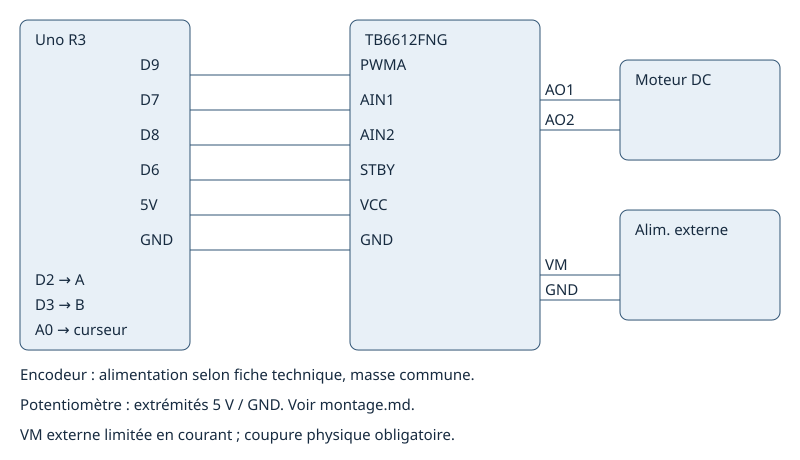

# Montage de référence (à valider avant alimentation)

| Uno | Module | Fonction |
|---|---|---|
| D2 | A encodeur | interruption |
| D3 | B encodeur | interruption |
| D9 | PWMA | PWM |
| D7 | AIN1 | sens |
| D8 | AIN2 | sens |
| D6 | STBY | activation |
| 5V | VCC TB6612 | logique |
| GND | GND module, encodeur et alimentation | masse commune |
| A0 | curseur potentiomètre | acquisition séparée |

AO1/AO2 vers moteur ; VM vers alimentation externe adaptée ; extrémités potentiomètre vers 5 V et GND. Alimentation encodeur selon sa fiche technique, sorties compatibles 5 V Uno ; résistances de tirage si sorties collecteur ouvert selon constructeur. Canal B inutilisé : entrées et PWM maintenus bas selon module. Prévoir découplage selon documentation du module. Ne jamais relier VM au 5 V Arduino. Ajouter une résistance de tirage vers GND sur STBY si le module n'en possède pas. Couper physiquement VM avant toute modification. Le logiciel ne constitue pas un dispositif de sécurité certifié.
